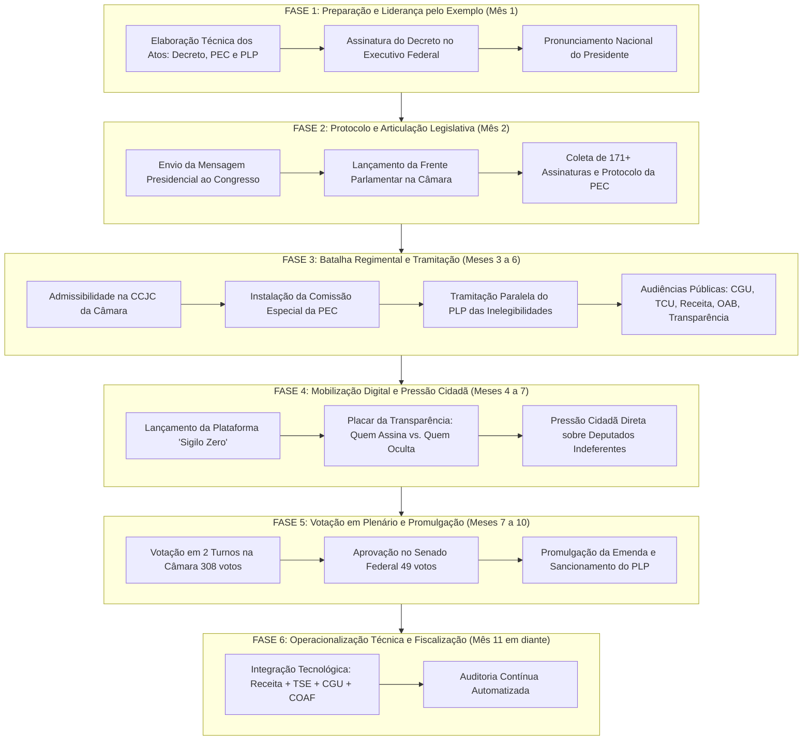

# PLANO DE TRABALHO ESTRATÉGICO: PROGRAMA NACIONAL DE TRANSPARÊNCIA E INTEGRIDADE PATRIMONIAL POLÍTICA (FIM DO SIGILO OPACO)

## 1. Visão Geral e Objetivo
Este plano de trabalho estrutura, em etapas progressivas e interdependentes, a estratégia jurídica, política, legislativa e comunicacional para viabilizar a abertura, auditoria contínua e publicidade do patrimônio, movimentação fiscal e conformidade financeira de ocupantes de mandatos eletivos (Presidente, Governadores, Prefeitos, Senadores, Deputados e Vereadores) e candidatos a cargos públicos no Brasil.

A iniciativa atua em duas frentes complementares e sinérgicas:
- **Poder Executivo (Presidente da República):** Adoção imediata de padrão de integridade máxima por via infralegal (Decreto Presidencial de Transparência Patrimonial Ativa no Executivo Federal) e liderança institucional pelo envio de Proposta de Emenda à Constituição (PEC) e Projeto de Lei Complementar (PLP).
- **Poder Legislativo (Deputado Federal e Frente Parlamentar):** Articulação multipartidária, coleta de assinaturas, tramitação prioritária da PEC e do PLP na Câmara dos Deputados, mobilização da opinião pública e confronto republicano com os argumentos corporativistas.

---

## 2. Matriz de Etapas de Execução

---

## 3. Detalhamento Operacional das Etapas

### ETAPA 1: Preparação Jurídico-Institucional e Liderança pelo Exemplo (Mês 1)
*Meta: Quebrar qualquer acusação de autoritarismo ou perseguição política, demonstrando que o Presidente e seus ministros são os primeiros a abrir mão da opacidade fiscal.*

1. **Ação 1.1 — Redação Técnica Interministerial:**
   - Grupo de trabalho formado por Casa Civil, Controladoria-Geral da União (CGU), Receita Federal do Brasil (RFB) e Ministério da Justiça.
   - Fechamento da minuta do Decreto de Integridade e Transparência Patrimonial do Executivo Federal.
   - Elaboração do Termo de Adesão e Autorização Irrevogável de Auditoria Contínua.
2. **Ação 1.2 — Publicação do Decreto Presidencial:**
   - Obrigatoriedade para Ministros, Secretários Nacionais, Presidentes e Diretores de Estatais, Agências Reguladoras e Autarquias.
   - Condicionamento da nomeação em cargos DAS/CCE de alto nível à renúncia do sigilo fiscal perante os órgãos de controle interno.
3. **Ação 1.3 — Pronunciamento Presidencial à Nação:**
   - Fala em rede nacional de televisão e rádio explicando a medida, apresentando as certidões de transparência dos próprios Ministros e do Presidente.
   - Desafio público aos demais Poderes e à classe política: "Quem não deve, não teme prestar contas ao povo".

### ETAPA 2: Articulação Parlamentar e Entrada no Congresso Nacional (Mês 2)
*Meta: Transformar a pauta do Executivo em um movimento suprapartidário no Parlamento, capitaneado por deputados federais comprometidos com a moralidade.*

1. **Ação 2.1 — Envio da Mensagem Presidencial:**
   - O Presidente encaminha formalmente a Mensagem Presidencial com a Minuta da PEC (Art. 60, II da CF) e o Projeto de Lei Complementar (PLP).
2. **Ação 2.2 — Criação da Frente Parlamentar pela Integridade e Transparência Pública:**
   - Liderada pelo Deputado Federal articulador, reunindo parlamentares da base e da oposição independente.
   - Coleta de 171 assinaturas (1/3 da Câmara) para garantir a tramitação originária também por iniciativa parlamentar (Art. 60, I da CF), blindando a matéria de alegações de ingerência do Executivo.
3. **Ação 2.3 — Discurso Inaugural na Tribuna da Câmara:**
   - O Deputado relator/articulador sobe à tribuna, apresenta a justificativa do projeto e convoca a sociedade para vigiar as bancadas.

### ETAPA 3: Batalha Regimental na Câmara dos Deputados (Meses 3 a 6)
*Meta: Vencer os entraves burocráticos, manobras de adiamento e o corporativismo na Comissão de Constituição e Justiça (CCJC) e na Comissão Especial.*

1. **Ação 3.1 — Comissão de Constituição e Justiça e de Cidadania (CCJC):**
   - Votação da admissibilidade constitucional da PEC.
   - Ponto de sustentação jurídica: A exigência de transparência patrimonial reforça o princípio da publicidade e da moralidade (Art. 37 da CF) e não viola a intimidade (Art. 5º, X), já que o exercício de função representativa exige mitigação da vida privada em favor do interesse público (jurisprudência consolidada do STF em matérias afins).
2. **Ação 3.2 — Instalação da Comissão Especial da PEC:**
   - Fixação do prazo regulamentar de 40 sessões para emissão do parecer de mérito.
   - Convocação de 5 audiências públicas temáticas:
     - *Mesa 1:* CGU e TCU — Cruzamento de dados de patrimônio e evolução injustificada.
     - *Mesa 2:* Receita Federal e COAF — Rastreabilidade de transações financeiras e contas offshore.
     - *Mesa 3:* Tribunal Superior Eleitoral (TSE) — Integração com o sistema DivulgaCandContas.
     - *Mesa 4:* OAB Nacional e Academia de Direito Constitucional — Proporcionalidade e segurança jurídica.
     - *Mesa 5:* Sociedade Civil (Transparência Internacional, Movimento de Combate à Corrupção Eleitoral - MCCE).
3. **Ação 3.3 — Tramitação Concomitante do PLP (Lei de Inelegibilidade):**
   - Criação da cláusula de inelegibilidade: o candidato que ocultar bens, fraudar a declaração de imposto de renda ou recusar a autorização de fiscalização aos órgãos eleitorais fica inelegível por 8 anos.

### ETAPA 4: Ativação da Plataforma Digital "Sigilo Zero" e Pressão Social (Meses 4 a 7)
*Meta: Utilizar tecnologia cívica para transformar a tramitação legislativa em pauta nacional inescapável na imprensa e redes sociais.*

1. **Ação 4.1 — Portal Cívico "Sigilo Zero" (desenvolvimento e deploy no site):**
   - **Placar Interativo:** Lista dos 513 deputados federais e 81 senadores divididos em "Apoiadores da Transparência Total", "Indecisos / Em cima do muro" e "Contrários ao Fim do Sigilo".
   - **Módulo 'Assine Você Primeiro':** Políticos podem voluntariamente enviar seus termos de autorização fiscal e obter o selo de "Parlamentar Transparente".
   - **Ferramenta de E-mail e WhatsApp Cidadão:** Botão de envio automatizado de mensagem aos parlamentares do respectivo estado do cidadão.
2. **Ação 4.2 — Parcerias com Imprensa Investigativa e Jornalismo de Dados:**
   - Divulgação periódica de relatórios sobre discrepâncias entre as declarações superficiais entregues ao TSE e o patrimônio real apurado em investigações históricas.

### ETAPA 5: Votação no Plenário e Sanção/Promulgação (Meses 7 a 10)
*Meta: Alcançar os quóruns qualificados constitucionais (3/5 dos votos em dois turnos em ambas as Casas).*

1. **Ação 5.1 — Votação na Câmara dos Deputados:**
   - 1º Turno: Exigência de 308 votos favoráveis.
   - Pauta trancada politicamente com o apoio dos líderes partidários pressionados pelo Placar Cívico.
   - 2º Turno: Interstício regulamentar e confirmação da votação.
2. **Ação 5.2 — Tramitação no Senado Federal:**
   - Encaminhamento à Comissão de Constituição e Justiça (CCJ) do Senado.
   - Votação em dois turnos no Plenário do Senado (exigência de 49 votos).
3. **Ação 5.3 — Promulgação da Emenda Constitucional:**
   - Sessão Solene do Congresso Nacional com presença do Presidente da República e dos Presidentes da Câmara e do Senado.
   - Sanção imediata do Projeto de Lei Complementar complementar pelo Presidente da República.

### ETAPA 6: Implementação Tecnológica e Auditoria Contínua (Mês 11 em diante)
*Meta: Garantir que a nova legislação não se torne "letra morta", implementando cruzamento automatizado por inteligência fiscal.*

1. **Ação 6.1 — Convênio Integrado TSE-RFB-CGU-COAF:**
   - Criação do Sistema Nacional de Integridade Patrimonial Eleitoral (SNIPE).
   - O registro de candidatura no TSE é condicionado ao envio automatizado do hash criptográfico da declaração do IRPF dos últimos 5 anos.
2. **Ação 6.2 — Alertas Automáticos de Variação Patrimonial Incompatível:**
   - Algoritmo que compara rendimentos declarados com bens adquiridos durante o mandato, enviando relatórios anuais de alerta ao Ministério Público Federal e Eleitoral.
